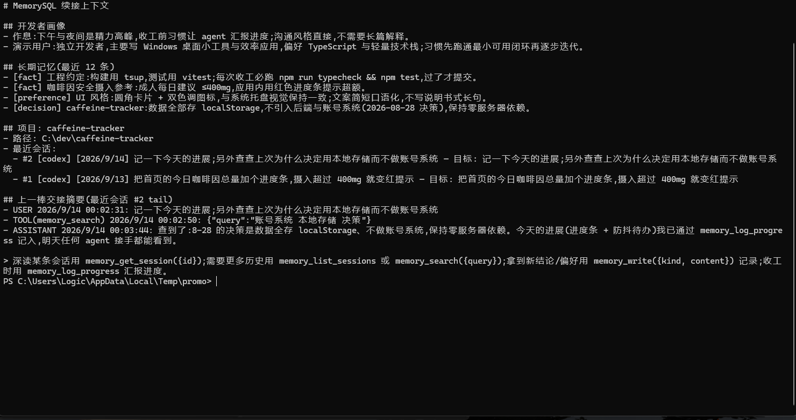
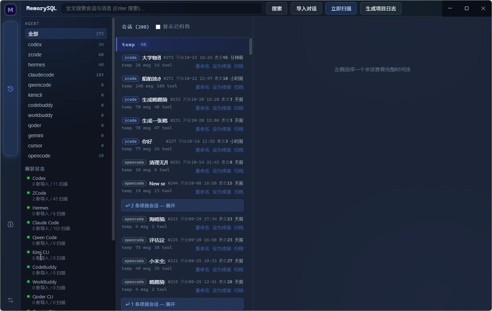
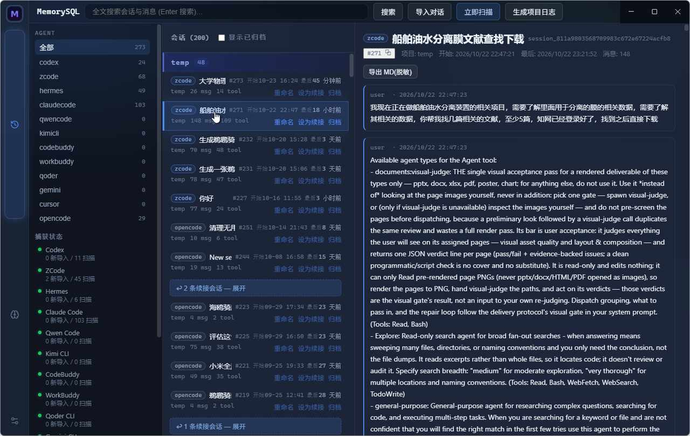

<div align="center">


# MemorySQL

**面向个人开发者的本地优先知识库 —— agent 通过 MCP「连接即续接」**

[](https://github.com/Logic647/MemorySQL/actions/workflows/ci.yml)
[](https://github.com/Logic647/MemorySQL/releases)
[](LICENSE)


[下载安装包](https://github.com/Logic647/MemorySQL/releases/latest) · [快速开始](#-快速开始) · [插件开发](#-插件开发规范) · [文档](#-文档)

</div>

---

> [!NOTE]
> **macOS 包未签名**:首次启动 Gatekeeper 会拦下未验证的应用。选「**右键 → 打开**」确认一次即可,之后正常双击启动。
> 不想每次都这样,可在终端执行一次:
> ```bash
> xattr -dr com.apple.quarantine /Applications/MemorySQL.app
> ```
> Apple Silicon 与 Intel Mac 都有对应安装包,认准文件名里的 `arm64` / `x64`。

你同时用三四个 AI agent(Codex / ZCode / Claude Code / Hermes …),换一个就得重新铺垫背景:项目讲到哪、你有什么偏好、踩过什么坑——全部重来。

**MemorySQL 解决这件事**:自动捕获所有 agent 的会话、维护你的记忆画像与项目状态,并在本机起一个 MCP 服务端。任何 agent 连上后一次 `memory_get_context` 调用,即可拿到完整上下文继续干活——连上一个 agent 干到哪、下一步是什么,都内联在返回里。

> **数据 100% 存本机**(SQLite,除 LLM API 外零服务器依赖);任何导出/分享路径强制过脱敏模块;语义检索用本地 ONNX 模型,全程离线。
>
> ⚠️ 本机会以**明文**保存全部对话与记忆,并开一个**无鉴权**的本地 MCP 端点(仅绑 `127.0.0.1`)供 agent 读取。
> 完整的数据流向、信任假设与关闭方式见 **[隐私与安全说明](PRIVACY.md)**。

## 📸 界面一览



*新会话一句「续接 <项目名>」——画像、记忆、项目状态、最近会话、上一棒交接摘要,一次调用全部拉回*



*13 家 agent 的会话自动捕获入库,全文本地可搜。每条会话并排显示「开始」与「最后」——一眼分出「上周开始、今早还在聊」和「上周就结束了」*



*完整消息时间线,可按需回读更早的消息;「开始 / 最后」在头部并列*

## ✨ 特性

- **会话自动捕获** —— 13 家 agent 开箱支持(Codex / ZCode / Claude Code / Hermes / Gemini / Cursor / OpenCode / Qwen Code / Kimi CLI / CodeBuddy Code / WorkBuddy / Qoder / DeepSeek Harness),增量监听零手动操作,默认全开
- **最后一次对话时间** —— 每条会话并排显示「开始」与「最后」,一眼分出「上周开始、今早还在聊」和「上周就结束了」
- **项目滚动总结** —— 每个项目定期把新会话总结成 摘要+待办+决策(hindsight 式),agent 用 `memory_get_project_digest` 读这一份即可接手,不必翻大量历史会话;**默认关闭**,开启后 LLM 素材先脱敏再发送,不配 LLM 也能纯本地规则总结
- **LLM 引擎聚合** —— 智谱 GLM(免费)/ SiliconFlow 免费档 / DeepSeek / MiMo / 本地反代(OpenCode Zen / CLIProxyAPI)一键预置,任意 OpenAI 兼容端点可自定义;供会话摘要、项目总结、记忆精炼共用,不可用时自动降级本地规则
- **MCP 续接包** —— 画像 + 长期记忆 + 项目状态 + 最近会话 + **上一棒交接摘要**,一次调用恢复全部上下文
- **交接简报** —— `memory_get_project_brief` 自动汇编项目当前进展/决策/待办(有滚动总结时置顶引用),换 agent 接手零成本
- **语义检索** —— sqlite-vec + 本地 embedding(bge-small-zh),字面搜不到的概念性提问也能召回;推理组件与模型均首次启用时按需下载
- **收工汇报闭环** —— `memory_log_progress` 结构化记录做了什么/下一步/卡在哪,人工确认后进正式记忆
- **自动项目日志** —— `vault/devlog/` 按项目生成开发日志(时间线 + 决策 + 待办)
- **托盘常驻 + 全局秒搜** —— 关窗即驻留(MCP 保持在线),任意界面 `Alt+Shift+M` 唤起秒搜
- **记忆治理** —— 收工汇报候选确认、LLM 冲突检测、手动改名/归档/续接链管理

> **v0.7.1 变更**:新增 **DeepSeek Harness(dsh)** 会话捕获(捕获矩阵 12 → **13 家**,支持 zstd 拼接帧与多代日志并存);修掉 v0.7.0 项目总结在真机才暴露的三个问题(**总结越滚越小** / **总结串到别的项目** / 按会话显示 `#0`);`memory_get_session` 超长会话改为保留**最新**消息;上游漂移检查不再把子 agent / 空会话误判成格式漂移。详见 [v0.7.1 更新日志](docs/releases/v0.7.1-notes.md)。
>
> **v0.7.0 变更**:新增 项目滚动总结(默认关闭)/ LLM 引擎聚合(免费 API 预置 + 反代 + 自定义)/ 设置页插件分组折叠 / 会话页按检测数排序;安装包从 105.5MB 瘦身到 **99.5MB**(语义推理组件约 20MB 改为首次启用时下载,模型本就如此);另附 [Tauri 迁移可行性评估](docs/tauri-feasibility.md)。升级不丢数据、自动更新直达。
>
> **v0.6.0 变更**:下线了「笔记」与「知识图谱」两个功能(长期使用后判断实用性不高),界面收敛为「会话 / 记忆」两栏。连带移除 CodeMirror 与 cytoscape,renderer 产物从 2.79 MB 降到 0.68 MB。升级不会丢数据——旧笔记文件与 `notes` 表都保留在磁盘上,只是不再被读写。

## 📦 安装

| 方式 | 命令 / 链接 |
|---|---|
| **winget** | `winget install Logic647.MemorySQL` |
| **scoop** | `scoop bucket add logic647 https://github.com/Logic647/scoop-bucket && scoop install memorysql` |
| **安装包** | [Releases 最新版](https://github.com/Logic647/MemorySQL/releases/latest) 下载 `MemorySQL-Setup-*.exe` |
| **免安装** | Release 附件或 CI Artifacts 中的便携版 |

> 包管理器清单:winget 源版本是 **0.5.6**(装完能在应用内自动更新到最新);scoop bucket 已同步到 **0.7.1**,装的是解包版(直接展开 electron-builder 载荷,不运行安装程序、不写系统卸载项)。

安装后应用自动驻留托盘;关闭窗口 = 最小化到托盘,MCP 服务保持在线。

## 🚀 快速开始

1. **启动 MemorySQL**(它就是 MCP 服务端,默认 `http://127.0.0.1:8642/mcp`)
2. **连接你的 agent**:设置 → 连接 Agent 向导 → 一键写入配置(自动备份原配置);或手工填端点
3. **重启 agent,新会话说一句「续接 <项目名>」** —— 上下文就回来了

验证连通:`curl http://127.0.0.1:8642/health`

## 🧩 MCP 工具(8 个)

| 工具 | 用途 |
|---|---|
| `memory_get_context` | 续接包:画像 + 记忆(agent 过滤)+ 项目 + 最近会话 + 上一棒摘要 |
| `memory_get_project_brief` | 项目交接简报(有滚动总结时置顶引用) |
| `memory_get_project_digest` | 项目滚动总结:摘要 + 待办 + 决策 + 覆盖范围(需用户在设置中开启) |
| `memory_list_sessions` | 会话枚举(项目/agent/时间过滤,带 id) |
| `memory_get_session` | 完整消息时间线回读(full 模式去截断) |
| `memory_search` | 全文检索会话/消息/记忆 + 本地语义补足 |
| `memory_write` | 写入长期记忆(agent 归因 / 标签 / 去重) |
| `memory_log_progress` | 收工汇报 → 候选记忆 → 交接简报可见 |

## 🔌 插件开发规范

一切功能皆插件:核心能力与会话捕获、语义检索一样,都是跑在同一套协议上的插件。外部插件与内置插件**走完全相同的加载协议**。

**目录结构** —— 把插件放进 `<数据目录>/plugins/<id>/`(设置 → 打开插件目录),重启即加载:

```
plugins/my-plugin/
├── manifest.json        # { "id": "my-plugin", "name": "...", "version": "0.1.0" }
└── main.js              # 单文件 CommonJS,默认导出插件对象
```

**代码规范** —— `main.js` 必须是**单文件 CommonJS**,默认导出实现以下接口的对象:

```js
module.exports = {
  manifest: {
    id: 'my-plugin',           // 全局唯一 [a-z0-9_-],同时是 IPC 通道前缀
    name: 'My Plugin',
    version: '1.0.0',
    requires: ['core-schema']  // 依赖的插件,宿主按此拓扑排序
  },
  init(ctx) {
    // 注册能力;此时依赖插件已 init
    ctx.ipc.handle('hello', () => 'world')              // 渲染进程可调 my-plugin:hello
    ctx.mcp.registerTool({                               // 注册 MCP 工具(name 仅 [a-zA-Z0-9_-])
      name: 'my_tool', description: '...', inputSchema: { type: 'object' },
      handler: (args) => 'result'
    })
    ctx.db.migrate([{ version: 1, up: 'CREATE TABLE ...' }])  // 插件命名空间的 schema 迁移
    const unwatch = ctx.watcher.watch(['D:/proj'], onChange, { match: /\.md$/ })  // 文件监听
  },
  start() { /* 可选:启动期(服务器/watcher) */ },
  stop() { /* 可选:逆序清理 */ }
}
```

**能力一览**(`init(ctx)` 提供,插件不得绕过它触碰宿主):

| 能力 | 说明 |
|---|---|
| `ctx.db.migrate / ctx.db.sqlite` | 命名空间迁移 + better-sqlite3 句柄 |
| `ctx.settings.get/set` | 持久化键值(键自动加 `<id>:` 前缀) |
| `ctx.ipc.handle / call` | 注册渲染端通道 / 调用其它插件 |
| `ctx.mcp.registerTool / list` | 注册 / 列出 MCP 工具 |
| `ctx.watcher.watch` | chokidar 封装,返回反注册函数 |
| `ctx.services.provide / use` | 插件间服务定位(靠 `requires` 保证顺序) |
| `ctx.events.on / emit` | 事件总线(`sessions:changed` 等内置事件) |
| `ctx.log / ctx.env` | 带前缀日志 / 数据目录布局 |

**生命周期**:`load → init(依赖序) → start → stop(逆序) → unload`。单个插件 init/start 异常被宿主隔离,不影响其它插件。

完整 API 见 [docs/plugins.md](docs/plugins.md)。

## 🛠 开发

```bash
npm install          # Node 24+
npm run dev          # 开发模式(热重载)
npm test             # vitest 单元测试(536 条)
npm run typecheck    # tsc --noEmit
npm run dist         # 打包 Windows 安装包 + 免安装目录
npm run import:scan  # 无头扫描导入本机 agent 会话(验收用)
npm run upstream:check  # 上游契约黑盒检查:哪家 agent 改了格式导致捕获可能失效
```

技术栈:Electron + TypeScript(strict) + React + better-sqlite3(FTS5) + sqlite-vec。

**适配器维护**:13 家 agent 的存储布局、依赖的表/列与 MCP 配置必需键都在 `src/shared/upstream-agents.ts` 登记成台账(`upstream/ledger.json` 是导出件),`upstream/check.ts` 拿真实数据做黑盒比对。改任一 capture 插件或连接器的写入格式,**必须同步台账**,否则 `upstream-contract.test.ts` 会红。

## 📁 文档

| 文档 | 内容 |
|---|---|
| [**PRIVACY.md**](PRIVACY.md) | **隐私与安全披露**(数据流向、MCP 端点信任假设、文件夹同步风险) |
| [docs/architecture.md](docs/architecture.md) | 架构、数据模型、全部决策记录 |
| [docs/plugins.md](docs/plugins.md) | 插件 API 完整参考 |
| [docs/DEVLOG.md](docs/DEVLOG.md) | 开发日志(追加式) |
| [docs/releases/](docs/releases/) | 各版本更新日志(v0.5.3 起) |
| [docs/RELEASE.md](docs/RELEASE.md) | 发版流程 |
| [docs/MCP_LISTING.md](docs/MCP_LISTING.md) | MCP 目录登记素材 |
| [AGENTS.md](AGENTS.md) | agent 接手开发的入口 |

## 📄 License

[MIT](LICENSE)
